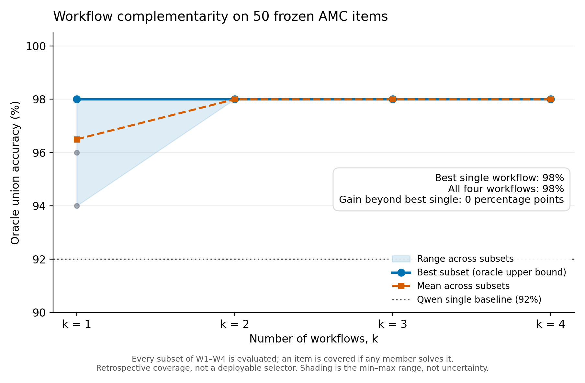

# AMC subset results: Qwen3.8-27B AutoRound INT4

Completed on **2026-11-16** using one NVIDIA B300 SXM6. All **250 evaluations** completed on the same **50 frozen AMC items**, selected with seed 42 from the local 655-item dataset. The full run after the pilot lasted 7 hours 56 minutes. This folder contains the final tables, graph, per-item results, correctness matrix, and run configuration.

## Table 1. AMC subset — single-model Qwen baseline

| Model | N | Decode / budget | Accuracy | Mean tokens |
|---|---|---|---|---|
| Qwen3.8-27B AutoRound INT4 | 50 | 1 rollout; T=0.0, p=1.0, seed=42, cap=131072, thinking=True | 92.0% | 12450.56 |

## Table 2. AMC subset — fixed workflows and oracle portfolio

| Workflow | N | Final accuracy | Wins vs Qwen | Mean tokens |
|---|---|---|---|---|
| W1: diverse ensemble | 50 | 96.0% | 2 | 40758.8 |
| W2: analytical + code | 50 | 98.0% | 3 | 47700.96 |
| W3: diverse + code | 50 | 94.0% | 2 | 38373.3 |
| W4: route + solver | 50 | 98.0% | 3 | 6711.38 |
| Oracle (W1–W4) | 50 | 98.0% | — | — |

The checkpoint is `MIRALABS/Qwen3.8-27B-W4A16-AutoRound`, revision `a6754efcde1ea362616353759f0c97507775a5a9`. Every call uses thinking enabled, temperature 0, top-p 1, seed 42, and at most **131,072 generated tokens including reasoning**. Context capacity is 262,144 tokens. Baseline has one rollout; workflows make multiple calls and therefore have a larger total allowance. Mean tokens sum **input plus generated tokens**, including reasoning, across all calls per item. Wins vs Qwen mean items solved by that workflow but missed by the baseline. Oracle means retrospective union coverage of W1–W4; it excludes the baseline.

## Accuracy versus number of workflows



For each integer **k = 1, 2, 3, 4**, enumerate every subset of k distinct workflows from W1–W4. A question is covered when **at least one member's final answer is correct**. Plot the best subset's union accuracy, the unweighted mean across subsets, and their min–max range. The baseline is a separate reference line and is never included in a workflow subset. The percentage axis is focused on 90–100%; the shaded range is variation between subsets, not a confidence interval.

| k | Number of subsets | Minimum accuracy | Mean accuracy | Best accuracy |
|---|---:|---:|---:|---:|
| 1 | 4 | 94% | 96.5% | 98% |
| 2 | 6 | 98% | 98% | 98% |
| 3 | 4 | 98% | 98% | 98% |
| 4 | 1 | 98% | 98% | 98% |

**Interpretation:** every workflow pair solves 49/50 items. W1 and W3 complement each other: their union reaches 98%, compared with 96% and 94% individually. W2 and W4 each already solve those same 49 items, so adding workflows yields **zero additional coverage beyond the best individual workflow** on this subset. W4 matches the highest accuracy with the lowest mean token count. These are descriptive results from 50 items, with retrospective oracle selection; they do not establish a deployable selector's accuracy or general population effects. No additional workflow optimization was performed for this plot.

## Completion and limitations

- Infrastructure failures: **0**.
- Calls reaching the 131,072-token output cap: **26** (baseline 3; W1 8; W2 9; W3 6; W4 0).
- Final parsing failures: **5** (baseline 3; W1 1; W2 1). These remain incorrect evaluations and are included in the denominators.
- Successful-stage caching and resume preserve completed evaluations. Wrong or unparseable answers are not regenerated because of their correctness.

## Files and provenance

- `table1_baseline.*`, `table2_portfolio.*`: original Markdown/CSV/LaTeX tables.
- `workflow_complementarity.png`, `.pdf`, `.svg`: Matplotlib figure for viewing and export.
- `workflow_subsets.csv`: all 15 subsets, their solved counts, and coverage gain over their own best member.
- `complementarity_by_k.csv`: graph values grouped by k.
- `correctness_matrix.*`: all 50 item IDs and baseline/W1–W4 final correctness.
- `evaluation_results.jsonl`: all 250 final result records, including outputs, candidate answers, grading status, token counts, and truncation counts.
- `manifest.json`: frozen item IDs, problems, reference solutions, and dataset hash.
- `config.json`, `metadata.json`, `sandbox.json`: original decoding, model, package, source-hash, and executor metadata. `pipeline_status.json` records full-run start and finish; `run_status.json` records completion.
- `summary.json`: original aggregate results, token breakdowns, overlaps, and diagnostics. `unique_wins` is baseline-relative; `workflow_exclusive_wins` is relative to the other workflows.
- `source_artifact_sha256.json`: SHA-256 hashes of the original copied experiment artifacts.
- `plot_environment.json`: plotting version and metric definition.

Original call-level traces, including reasoning, remain at `/scratch1/mendeza/flowbank-amc/results/amc50/`; they are not included in this repository archive. Plotting and summarizing these saved results makes no model calls.

To regenerate the plot and its two CSV files from the repository root, use a Python environment with Matplotlib 3.10.8:

```bash
python scripts/plot_workflow_complementarity.py \
  --results-dir experiment_results/amc50_qwen38_autoround_int4
```

In the current workspace, that plotting package is installed in the separate scratch test environment, leaving the experiment runtime untouched:

```bash
MPLCONFIGDIR=/scratch1/mendeza/flowbank-amc/cache/matplotlib \
  /scratch1/mendeza/flowbank-amc/test-env/bin/python \
  scripts/plot_workflow_complementarity.py
```

Experiment instructions: [B300 scavenger guide](../../B300_SCAVENGER.md), [runtime guide](../../RUN_AMC.md), [frozen plan](../../AMC_EXPERIMENT_PLAN.md).
