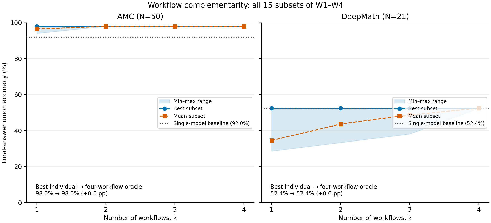
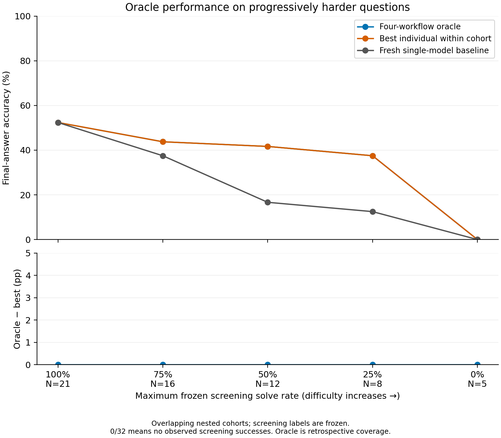

# DeepMath workflow complementarity

All 105 fresh evaluations on 21 adaptively screened questions are complete. Baseline: 52.4%; best individual: 52.4%; four-workflow oracle: 52.4%; gain: 0.0 percentage points.

Screening correct/32 values are frozen selection labels, not fresh baseline results. Conclusions apply to these 21 selected questions. Oracle uses final answers and ground truth retrospectively; it is an upper bound, not a deployable selector. Cohorts overlap and are defined solely by frozen screening rates. 0/32 means no observed screening successes, not unsolvability. Best individual is recomputed within each cohort.

| Maximum screening rate | N | Oracle solved | Best individual solved | Baseline solved | Gain (pp) |
|---|---|---|---|---|---|
| 100% | 21 | 11 | 11 | 11 | 0.0 |
| 75% | 16 | 7 | 7 | 6 | 0.0 |
| 50% | 12 | 5 | 5 | 2 | 0.0 |
| 25% | 8 | 3 | 3 | 1 | 0.0 |
| 0% | 5 | 0 | 0 | 0 | 0.0 |

**Exploratory; dataset audit pending.** Parse failures count as unsuccessful screening responses; bucket labels do not establish verified mathematical difficulty. Screening used temperature 0.6; the fresh baseline uses temperature 0. Archived AMC used a different quantized checkpoint, so cross-dataset differences do not isolate difficulty.

Reference concerns were frozen before inference; supplied labels remain unchanged. See private reference_preflight.json and manifest.json. Proof validity is not graded.

[Baseline table](../table1_baseline.md) · [Portfolio table](../table2_portfolio.md) · [Costs and failures](condition_diagnostics.csv)

Reproduce: `bash scripts/run_screened21.sh analyze`. Private questions, solutions and traces stay on scratch; publishing them requires separate authorization.

## Controlled generated-token allowances

Baseline has 131,072 generated tokens per question. Each complete W1–W4 workflow has 32,768, so the whole portfolio has the same maximum 131,072. Reasoning, selection, verification and code retries all count. Input tokens and executor compute are measured separately and are not controlled. Equal allowances do not imply equal actual spending.

[Budget compliance](../budget_compliance.json) · [Measured costs](generated_budget_costs.csv) · [Independent buckets](independent_bucket_metrics.csv)

| Screening correct / 32 | N | Baseline solved | Oracle solved | Oracle accuracy |
|---|---:|---:|---:|---:|
| 0/32 | 5 | 0 | 0 | 0.0% |
| 1-8/32 | 3 | 1 | 3 | 100.0% |
| 9-16/32 | 4 | 1 | 2 | 50.0% |
| 17-24/32 | 4 | 4 | 2 | 50.0% |
| 25-32/32 | 5 | 5 | 4 | 80.0% |

Oracle uses ground truth retrospectively. This comparison does not implement an answer selector or a repeated direct-sampling control. Stage allocations are fixed design choices; truncating intermediate reasoning can affect workflow quality. The selection is small and adaptively screened; manual audit remains pending.

Reproduce budgeted analysis: `bash scripts/run_budget21.sh analyze`.
