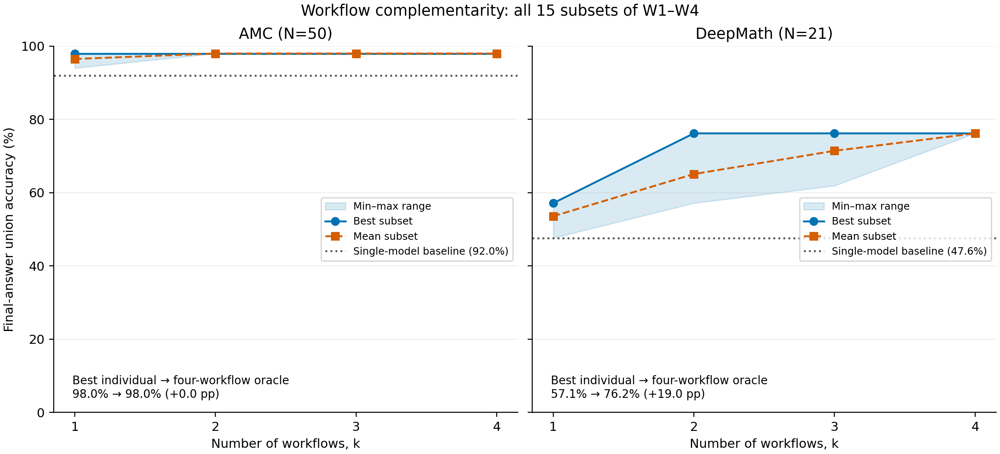
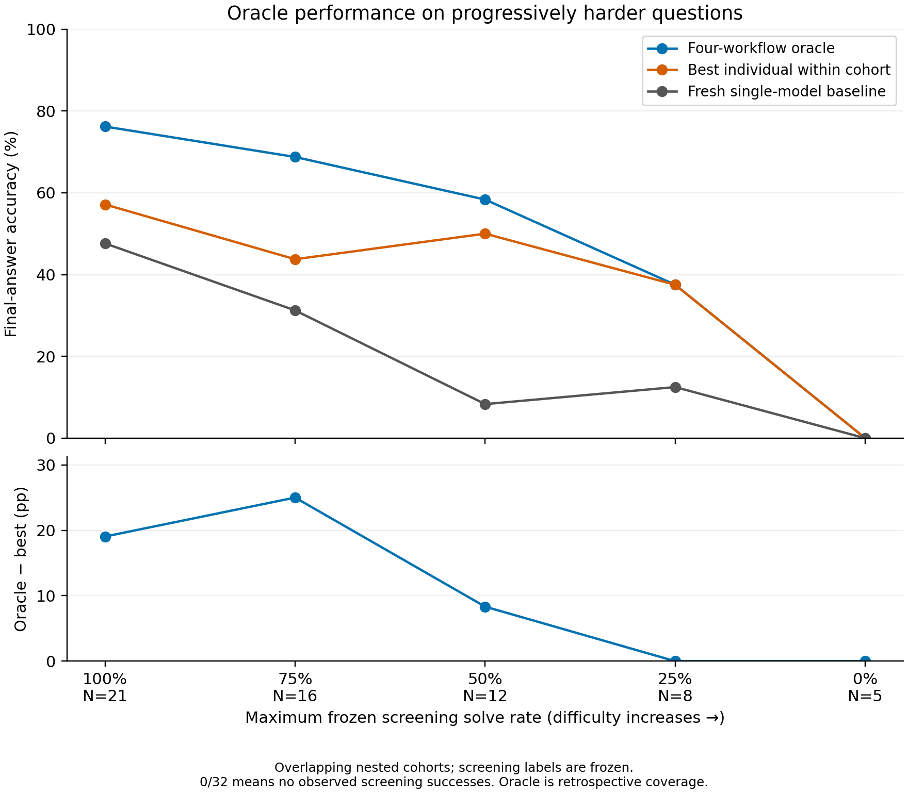

# DeepMath workflow complementarity

All 105 fresh evaluations on 21 adaptively screened questions are complete. Baseline: 47.6%; best individual: 57.1%; four-workflow oracle: 76.2%; gain: 19.0 percentage points.

Screening correct/32 values are frozen selection labels, not fresh baseline results. Conclusions apply to these 21 selected questions. Oracle uses final answers and ground truth retrospectively; it is an upper bound, not a deployable selector. Cohorts overlap and are defined solely by frozen screening rates. 0/32 means no observed screening successes, not unsolvability. Best individual is recomputed within each cohort.

| Maximum screening rate | N | Oracle solved | Best individual solved | Baseline solved | Gain (pp) |
|---|---|---|---|---|---|
| 100% | 21 | 16 | 12 | 10 | 19.0 |
| 75% | 16 | 11 | 7 | 5 | 25.0 |
| 50% | 12 | 7 | 6 | 1 | 8.3 |
| 25% | 8 | 3 | 3 | 1 | 0.0 |
| 0% | 5 | 0 | 0 | 0 | 0.0 |

**Exploratory; dataset audit pending.** Parse failures count as unsuccessful screening responses; bucket labels do not establish verified mathematical difficulty. Screening used temperature 0.6; the fresh baseline uses temperature 0. Archived AMC used a different quantized checkpoint, so cross-dataset differences do not isolate difficulty.

Reference concerns were frozen before inference; supplied labels remain unchanged. See private reference_preflight.json and manifest.json. Proof validity is not graded.

[Baseline table](../table1_baseline.md) · [Portfolio table](../table2_portfolio.md) · [Costs and failures](condition_diagnostics.csv)

Reproduce: `bash scripts/run_screened21.sh analyze`. Private questions, solutions and traces stay on scratch; publishing them requires separate authorization.
