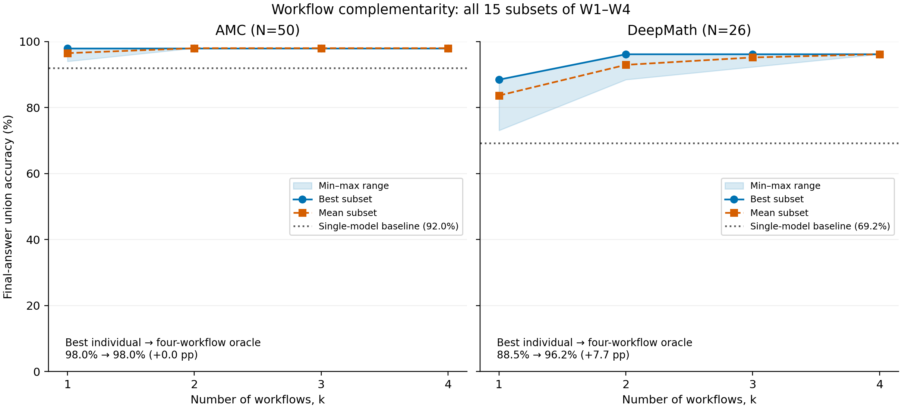
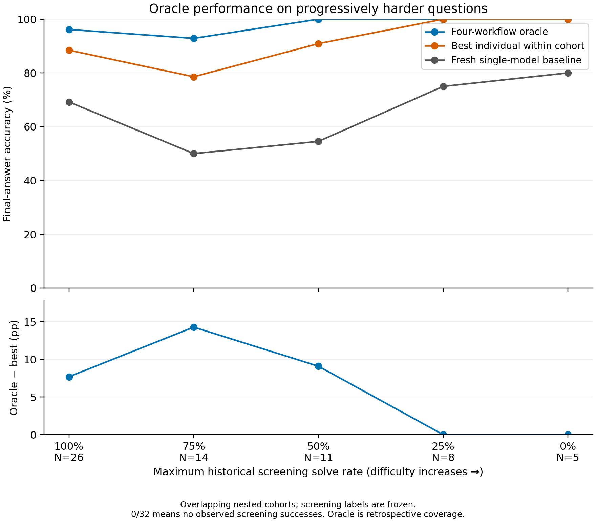

# DeepMath screened subset: Qwen3.8-27B AutoRound INT4

All **130 evaluations** on the **26 frozen screened questions** completed on November 17, 2026, at **4:48 PM Eastern**. Elapsed time, including the pilot and a documented grading-parser correction, was approximately **4 hours 5 minutes** on one NVIDIA B300 with two concurrent requests.

| Condition | Solved | Final accuracy | Wins over fresh baseline | Mean input + output tokens |
|---|---:|---:|---:|---:|
| Single-model baseline | 18/26 | 69.2% | — | 7,226.31 |
| W1: diverse ensemble | 19/26 | 73.1% | 2 | 35,807.65 |
| W2: analytical + code | 23/26 | 88.5% | 6 | 49,359.85 |
| W3: diverse + code | 23/26 | 88.5% | 5 | 47,617.50 |
| W4: route + solver | 22/26 | 84.6% | 6 | 14,009.92 |
| Oracle union of W1–W4 | 25/26 | 96.2% | — | — |

The four-workflow oracle adds **2 questions (+7.7 percentage points)** over the best individual workflow and **7 questions (+26.9 points)** over the fresh single-model baseline. One question is unsolved by every workflow. Wins over baseline count solved questions that the baseline missed; they are not net accuracy differences. Mean token costs include input and generated reasoning/output across all calls of a condition.

## Complementarity by portfolio size



Both panels enumerate all 15 subsets of W1–W4. Subset coverage is the fraction of items solved by at least one member's **final answer**. The best subset, unweighted mean, and min–max range use a shared 0–100% accuracy axis. Baselines are separate reference lines and excluded from workflow unions. Shading describes variation across subsets, not uncertainty.

On the archived AMC subset, best-individual and four-workflow coverage are both 98%. On DeepMath they are 88.5% and 96.2%. This is a descriptive comparison of two selected subsets, not a controlled causal estimate of difficulty's effect.

## Nested historical screening cohorts



| Maximum historical screening rate | N | Oracle solved | Best individual solved | Fresh baseline solved | Oracle − best (pp) |
|---|---:|---:|---:|---:|---:|
| 100% | 26 | 25 | 23 | 18 | 7.7 |
| 75% | 14 | 13 | 11 | 7 | 14.3 |
| 50% | 11 | 11 | 10 | 6 | 9.1 |
| 25% | 8 | 8 | 8 | 6 | 0.0 |
| 0% | 5 | 5 | 5 | 4 | 0.0 |

**The results do not show a monotonic increase in complementarity as historical screening rates decrease.** Gains peak at the 75% threshold and disappear in the two lowest-rate cohorts. In the five-item cohort with no observed screening successes (0/32), W2, W3, and W4 each solve all five; the fresh baseline solves four. The historical rates therefore do not predict low fresh baseline accuracy consistently under this experiment's settings.

Cohorts are overlapping, nested, and frozen from historical labels before inference; the best individual is recomputed within each cohort. Historical decoding, quantization, and grading settings are undocumented, and the original screening responses are unavailable. Grading differences cannot be separated from other differences. “0/32” means no observed screening successes, not unsolvability. Selection was adaptive; conclusions apply to these 26 questions. The oracle uses correctness retrospectively and is an upper bound, not a deployable selector.

## Configuration and diagnostics

The model is `MIRALABS/Qwen3.8-27B-W4A16-AutoRound`, pinned to `a6754efcde1ea362616353759f0c97507775a5a9`. Dataset revision: `e723e4604d862e25fa2c57313a7c37494a674c03`. All conditions use thinking enabled, temperature 0, top-p 1, seed 42, and a **131,072 generated-token cap per call**, including reasoning. Context capacity is 262,144 tokens. Workflow prompts, routing, execution limits, and retry rules follow the AMC experiment; workflow budgets sum multiple calls and exceed the single-rollout baseline budget.

- Completed evaluations: **130/130**, with **444 model calls** and complete usage records.
- Tokens: **350,816 input + 3,653,736 generated**.
- Infrastructure failures: **0**.
- Final-answer parsing failures: **6** (baseline 1; W1 3; W3 1; W4 1).
- Calls reaching the output cap: **7** (W1 1; W2 2; W3 3; W4 1).

Parsing failures remain incorrect in every denominator. Truncation is a call-level diagnostic and need not imply a wrong final evaluation. Reference concerns were recorded before inference without changing the supplied labels; some tasks request proofs or justifications, whose validity final-answer grading does not establish.

The initial pilot exposed a parser bug: an explicit boxed “Yes” followed by justification was rejected. The parser was corrected and regression-tested; original pilot artifacts were retained. Fourteen successful model-call checkpoints were reused and results recomputed under the corrected grader with a fresh source/configuration record. Gold labels, generation prompts, model, and decoding settings did not change. No subsequent grading changes were applied to the reported run.

## Files and reproduction

- `table1_baseline.*`, `table2_portfolio.*`: original Markdown/CSV/LaTeX result tables.
- `figure1_complementarity.*`, `figure2_harder_cohorts.*`: PNG/PDF/SVG figures. Figure 2 was rendered from the same aggregates with a corrected top margin; original run figures remain on scratch.
- `all_subset_coverage.csv`: all 15 workflow subsets for each dataset, with solved counts and union accuracy.
- `complementarity_by_k.csv`: baseline and best/mean/min subset coverage by k.
- `cohort_metrics.csv`: nested-cohort N, solved counts for every condition, and complementarity gains.
- `condition_diagnostics.csv`: mean costs, parsing failures, and truncations by condition.
- `summary.json`: aggregate accuracy, overlap, baseline-relative wins, solution losses, and token costs.
- `provenance.json`: model/dataset revisions, source/configuration hashes, package versions, totals, and grading-correction record.
- `source_artifact_sha256.json`: SHA-256 checksums of artifacts copied unchanged from scratch. Published figure checksums are also recorded in `provenance.json`.

Private questions, references, solutions, item-level records, and raw traces remain on scratch. These public aggregate artifacts can reproduce both figures without accessing private inputs or making model calls:

```bash
python -m pip install -r requirements.analysis.txt
python -m amc_repro.deepmath_analysis plot \
  --results-dir experiment_results/deepmath26_qwen38_autoround_int4 \
  --output-dir /scratch1/mendeza/flowbank-amc/deepmath/replot
```

Run from the repository root with the project dependencies installed. Full evaluation/reanalysis requires the private frozen inputs: see [experiment plan](../../DEEPMATH_EXPERIMENT_PLAN.md) and [run commands](../../RUN_DEEPMATH.md). The AMC panel is recomputed from the [archived AMC correctness matrix](../amc50_qwen38_autoround_int4/correctness_matrix.csv); those artifacts were preserved.
